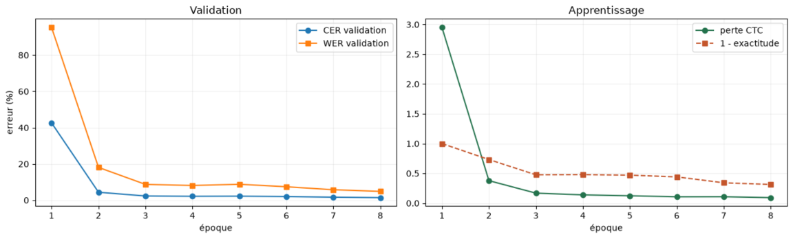

# Moroccan Darija OCR

CNN + BiLSTM + CTC OCR pipeline for Moroccan Arabic line images, with a trained Arabic baseline and an explicit path for Darija adaptation.

The current baseline was trained on the Moroccan Official Gazette and tested on 1,212 held-out lines. The project reached 1.49% CER and 6.94% WER on that Arabic printed-text test. These numbers do not represent Darija performance.

See the complete setup, training commands, dataset audit, and adaptation instructions in [arabic_ocr/README.md](arabic_ocr/README.md).

The local demo accepts a line or a simple single-column page and returns text plus line coordinates.
Follow the [inference and demo guide](arabic_ocr/docs/USAGE.md). Gradio is an optional installation.

For a complete explanation in French, read the [theory and technical course](arabic_ocr/docs/COURS_OCR.md),
the [worked exercises](arabic_ocr/docs/EXERCICES_OCR.md), or download the
[32-page course PDF](arabic_ocr/docs/cours_moroccan_darija_ocr.pdf).

Historical Darija experiments use synthetic images. A [reproducibility audit](arabic_ocr/docs/EXPERIMENT_AUDIT.md)
records their split and rendering limitations; new synthetic generation preserves source groups and diacritics.

The repository intentionally excludes raw datasets and AtlasOCR's large Parquet shards. AtlasOCR inspection found page/paragraph images without published line-level boxes, so the adaptation tools refuse unverified multiline supervision.
