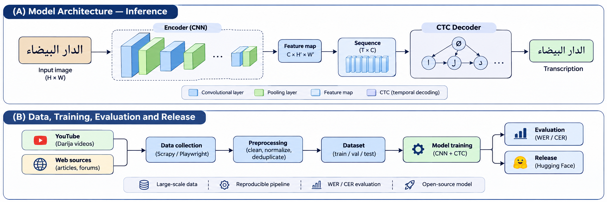
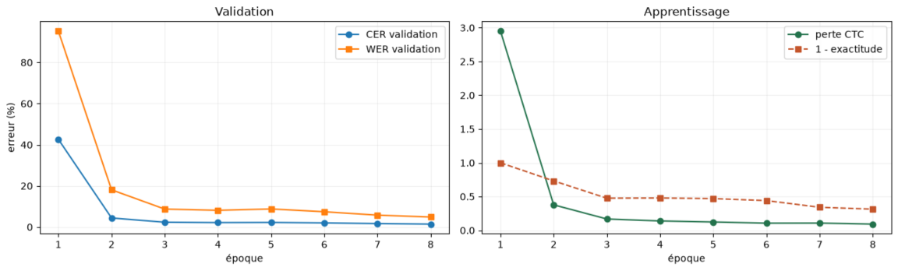
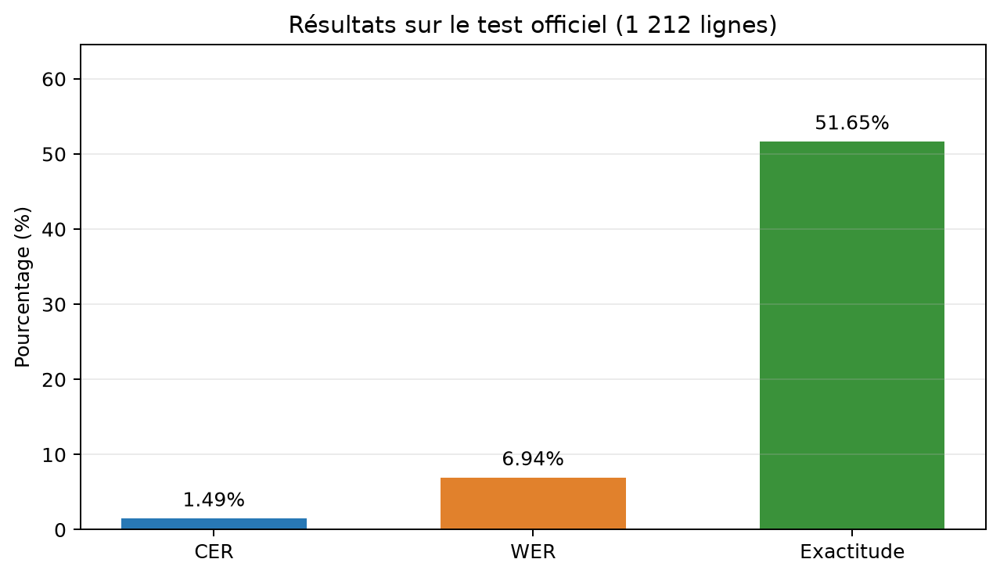
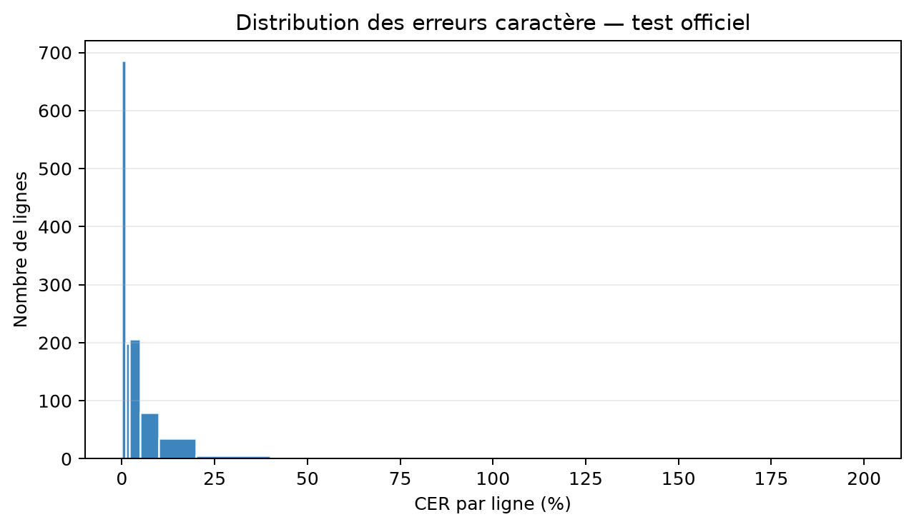
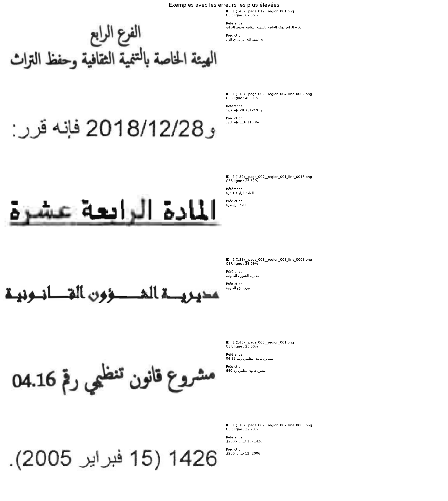

# OCR arabe : CNN + BiLSTM + CTC

Pipeline PyTorch pour reconnaître des **images de lignes déjà découpées** du Bulletin officiel marocain. Il comprend le téléchargement vérifié, la préparation des splits, l'entraînement CUDA, l'évaluation CER/WER et l'inférence sur une ligne.

Les mesures de l'exécution sur RTX 5070 et les exemples de prédictions figurent dans [RESULTS.md](RESULTS.md). Ce corpus contient de l'arabe imprimé administratif ; il ne permet pas de mesurer les performances en darija. Cette adaptation demandera des images et transcriptions représentatives supplémentaires.

L'audit du format AtlasOCR, le chevauchement observé entre ses tests et AtlasOCRBench et la préparation des annotations de lignes sont décrits dans [ATLAS_NEXT.md](ATLAS_NEXT.md). Le script `inspect_atlas.py` reproduit cette inspection sans télécharger les fichiers Parquet complets.

Pour préparer une revue humaine bornée d'images AtlasOCR réelles :

```powershell
python -X utf8 inspect_atlas.py --output-dir ../../work/atlas_review_v1 --rows 20 --images
python -X utf8 build_atlas_review_manifest.py --audit-dir ../../work/atlas_review_v1 --output-dir ../../work/atlas_review_v1/manual_review
```

Le dossier `manual_review/` contient une planche de contact et un manifest marqué
`needs_manual_line_annotation`. Les textes de page ne sont jamais copiés automatiquement vers des crops ; après
annotation manuelle, seuls les couples ligne-image/transcription vérifiés doivent être passés au validateur.

Deux notebooks sont disponibles dans `notebooks/` : `01_dataset_visualization.ipynb` explore les images et transcriptions, tandis que `02_training_visualization.ipynb` affiche les courbes d'apprentissage, les métriques du test et les erreurs visuelles. Ils utilisent les sorties déjà présentes et ne téléchargent pas de nouvelles données.

L'architecture complète du pipeline, du corpus jusqu'à la publication du checkpoint, est décrite dans
[`docs/architecture.md`](docs/architecture.md).




`03_test_images_transcriptions.ipynb` affiche les images du test officiel avec la référence, la prédiction et le CER de chaque ligne. Il exporte aussi `runs/baseline/test/test_images_transcriptions_gallery.png`.



### Résultats visuels du modèle

| Mesure | Test officiel |
|---|---:|
| CER | **1,49 %** |
| WER | **6,94 %** |
| Exactitude des lignes | **51,65 %** |
| Débit | **380,9 lignes/s** |



La distribution ci-dessous montre que la majorité des lignes ont une erreur faible, tandis qu'un petit nombre de
lignes difficiles concentre les erreurs élevées.





Les chiffres ci-dessus correspondent uniquement au Bulletin officiel arabe et ne constituent pas encore une mesure de
performance sur la darija. La séparation entre données synthétiques, données réelles et benchmark est décrite dans
`ATLAS_NEXT.md`.

Pour préparer une adaptation, fournissez d'abord des manifests `train.jsonl` et `val.jsonl` contenant uniquement des couples vérifiés image d'une ligne / transcription d'une ligne. Le validateur refuse les paragraphes multiligne et les séquences CTC impossibles :

```powershell
python -X utf8 prepare_line_manifest.py --input-dir ../../work/darija_lines_raw --output-dir ../../work/darija_lines --normalize
python -X utf8 adapt.py --base-checkpoint runs/baseline/best.pt --data-dir ../../work/darija_lines --output runs/darija/init.pt
python -X utf8 train.py --data-dir ../../work/darija_lines --run-dir runs/darija --epochs 10 --batch-size 16 --height 64 --max-width 1600 --hidden-size 128 --channels 32 --seed 42 --device cuda --resume runs/darija/init.pt
```

`adapt.py` agrandit le classifieur CTC, recopie les poids des caractères déjà appris et initialise les nouveaux caractères. Il ne fabrique pas de crops et ne transforme pas une annotation de paragraphe en pseudo-lignes.

Le validateur contrôle aussi les dimensions minimales des images et refuse les doublons d'image dans un même split. Ces contrôles évitent d'introduire silencieusement des exemples inutilisables ou une fuite entre lignes.

Pour les pages AtlasOCR qui possèdent réellement une transcription avec un retour à la ligne par ligne, `segment_page_lines.py` peut produire les crops. Il refuse les paragraphes sans retours à la ligne et s'arrête si le nombre de lignes détectées ne correspond pas au nombre de transcriptions :

```powershell
python -X utf8 segment_page_lines.py --input pages.jsonl --input-root . --output-dir lines --output-jsonl lines.jsonl
```

Pour générer des lignes synthétiques à partir d'un fichier texte DODa (`.txt`, `.csv` ou `.jsonl`) :

```powershell
python -X utf8 generate_synthetic_lines.py --texts doda_sentences.txt --fonts C:\Windows\Fonts\arial.ttf --output-dir ..\darija_synthetic\images --output-data-dir ..\darija_synthetic\manifests --val-ratio 0.1 --seed 42
```

Les images synthétiques servent au pré-entraînement et à l'augmentation. Elles ne remplacent pas les images réelles
AtlasOCR pour l'évaluation finale.

Si l'annotation manuelle n'est pas possible, `fetch_atlas_texts.py` récupère un nombre borné de transcriptions
AtlasOCR et les découpe en segments courts. Ces textes peuvent ensuite être rendus en images par
`generate_synthetic_lines.py` :

```powershell
python -X utf8 fetch_atlas_texts.py --output ../../work/atlas_synthetic/atlas_texts.jsonl --rows 1000 --max-chars 100
python -X utf8 generate_synthetic_lines.py --texts ../../work/atlas_synthetic/atlas_texts.jsonl --fonts C:\Windows\Fonts\arial.ttf C:\Windows\Fonts\tahoma.ttf --output-dir ../../work/atlas_synthetic/images --output-data-dir ../../work/atlas_synthetic/manifests --seed 42 --augment
```

Un premier essai automatique a produit **5 388 lignes synthétiques** (4 849 train / 539 validation). Après trois
époques sur RTX 5070 : CER **13,22 %**, WER **41,68 %**, exactitude **0,56 %**. Ces chiffres mesurent la difficulté
du corpus synthétique Atlas, pas la qualité sur des images réelles.

Un second passage applique un filtre de scripts pour écarter les caractères étrangers accidentels. Il produit **5 329
lignes** (4 796 train / 533 validation, 181 caractères). Après trois époques : CER **6,63 %**, WER **15,01 %** et
exactitude **15,20 %**. Ce modèle est l'expérience synthétique la plus propre actuellement, mais reste un modèle de
pré-entraînement : aucune image n'est une photographie réelle annotée.

L'option `--augment` applique des variations légères de rotation, contraste, flou et bruit pour simuler des scans ou
des captures imparfaites. Un test de génération augmenté a été validé sur 100 exemples ; les tests du projet restent
à **18 réussis**.

### Comparaison augmentation

| Expérience | CER | WER | Exactitude ligne |
|---|---:|---:|---:|
| Atlas synthétique filtré, sans augmentation | **6,63 %** | **15,01 %** | **15,20 %** |
| Atlas synthétique filtré, augmentation légère | 9,52 % | 22,36 % | 7,50 % |

Sur ce premier essai de trois époques, l'augmentation est trop agressive pour les images synthétiques utilisées.
Le modèle sans augmentation reste le meilleur checkpoint ; les transformations seront réduites et réintroduites
progressivement après ajout de données plus variées.

### Premier corpus synthétique DODa

Un premier sous-ensemble reproductible de **5 000 phrases arabes Darija** a été généré localement depuis
`work/doda/sentences/sentences.csv` (colonne `darija_ar`). Après déduplication et contrôle CTC, il contient
**4 500 lignes d'entraînement**, **500 lignes de validation** et **74 caractères**. Les manifests validés sont dans
`work/darija_synthetic_v2/validated/`. Ce corpus est un point de départ pour vérifier le pipeline, pas encore une
évaluation de la robustesse sur des documents réels.

Un contrôle rapide de **3 époques sur la RTX 5070** atteint sur cette validation synthétique **2,21 % de CER**,
**9,92 % de WER** et **61,4 % de lignes exactes**. Ce résultat confirme que le pipeline apprend les textes générés ;
il ne représente pas une performance sur des documents Darija réels. Deux caractères vocalisés absents du vocabulaire
d'entraînement sont signalés dans `runs/darija_synthetic_v2/val/metrics.json`.

## Installation sous Windows / PowerShell

Exécuter les commandes depuis le dossier contenant ce README. Python 3.12 a été utilisé pour cette exécution. Un environnement virtuel est conseillé pour une nouvelle installation :

```powershell
python -m venv .venv
.\.venv\Scripts\Activate.ps1
python -m pip install torch --index-url https://download.pytorch.org/whl/cu128
python -m pip install -r requirements.txt
python -c "import torch; print(torch.__version__, torch.version.cuda); print(torch.cuda.get_device_name(0)); print(torch.randn(32,32,device='cuda').square().mean().item())"
```

Le dernier appel effectue un calcul CUDA réel. L'environnement utilisé ici contient **PyTorch 2.11.0 + CUDA 12.8** ; les versions exactes sont enregistrées dans `runs/baseline/config.json`. Les commandes d'installation ci-dessus ne figent pas les versions futures ; consulter [l'installation officielle de PyTorch](https://pytorch.org/get-started/locally/) si une nouvelle installation diffère.

## Préparer les données

Le téléchargement représente environ 148,5 Mo. Dans l'arborescence livrée, les fichiers bruts, images et manifests se trouvent dans `../../work/data/gazette` :

```powershell
python -X utf8 prepare_data.py --data-dir ../../work/data/gazette --seed 42 --val-fraction 0.1
```

Le script vérifie les MD5 annoncés ainsi que les SHA-256 fournis par l'auteur, contrôle les chemins de l'archive et réutilise les fichiers déjà vérifiés. Il produit `train.jsonl`, `val.jsonl`, `test.jsonl`, `vocab.json`, `quarantine.json` et `data_audit.json`.

| Split | Lignes |
|---|---:|
| Entraînement | 10 357 |
| Validation | 1 160 |
| Test officiel | 1 212 |

Les 1 212 fichiers du test sont exclus du corpus global. La validation est choisie par groupes de pages avec la graine 42. Les copies ayant une image identique ou une transcription normalisée identique à un autre split sont retirées du corpus d'apprentissage : 102 lignes recouvrant le test, puis 57 recouvrant la validation. Il ne reste aucun chevauchement entre splits par nom de fichier, SHA-256 d'image ou texte normalisé. Le vocabulaire contient **92 caractères issus uniquement de l'entraînement**, sans caractère inconnu en validation ou test.

Deux exemples d'entraînement supplémentaires sont mis en quarantaine après inspection visuelle : `1 (157)__page_001__region_010.png` contient une annotation de zéros incompatible avec la date visible ; `1 (183)__page_026__region_001.png` contient deux lignes visuelles. Ces exclusions sont limitées à ces identifiants et ne modifient ni la validation ni le test. Leur texte original et leur motif d'exclusion figurent dans `quarantine.json`. Les autres répétitions de ponctuation sont conservées.

Les transcriptions reçoivent une normalisation Unicode NFC et une réduction des espaces ; lettres, diacritiques, tatweel et ponctuation sont conservés. Les textes restent en ordre Unicode logique. Pour **38 fichiers**, le texte du test officiel diffère de celui de `merged.jsonl` : la version officielle du test est conservée. Quatre pages sont représentées dans l'entraînement et le test officiel ; les résultats ne démontrent donc pas une généralisation à des documents entièrement nouveaux. L'audit détaille ces choix et les lignes concernées.

Les manifests utilisent des chemins d'images absolus. Si le projet est déplacé, relancer la préparation avec un dossier de données accessible pour les régénérer.

## Entraîner sur la RTX 5070

Commande de la première expérience :

```powershell
python -X utf8 train.py --data-dir ../../work/data/gazette --run-dir runs/baseline --epochs 8 --batch-size 16 --height 64 --max-width 1600 --hidden-size 128 --channels 32 --lr 0.001 --seed 42 --device cuda --workers 0
```

L'AMP float16 est activée par défaut sur CUDA ; la perte CTC reste en float32. `--no-amp` permet de la désactiver. L'entraînement utilise AdamW, un écrêtage des gradients à 5 et une réduction du taux d'apprentissage lorsque le CER de validation stagne. Le checkpoint `best.pt` est choisi **uniquement sur le CER de validation** ; `last.pt` permet de reprendre l'apprentissage. Le test officiel est évalué séparément.

Le modèle applique six convolutions, avec des canaux 32/64/128/256 et un sous-échantillonnage horizontal par 4. Après réduction de la hauteur, les caractéristiques valides sont parcourues de droite à gauche puis transmises à deux couches BiLSTM de 128 unités par direction. Une projection produit les 92 caractères et le symbole CTC blanc d'indice 0. Le décodage est glouton, sans modèle de langue.

Les images sont converties en niveaux de gris, les transparences compositées sur fond blanc, puis redimensionnées à hauteur 64. La largeur proportionnelle est plafonnée à 1 600 pixels. Les lots regroupent des largeurs proches et le BiLSTM ignore le padding. Le prétraitement d'image ne dépend jamais du texte attendu ; les séquences CTC impossibles provoquent une erreur explicite. Le parcours RTL global reste une approximation pour les lignes mêlant arabe, nombres et segments latins.

Les fichiers de suivi sont `config.json`, `history.jsonl`, `best.pt` et `last.pt` dans le dossier du run. Pour poursuivre jusqu'à 20 époques :

```powershell
python -X utf8 train.py --data-dir ../../work/data/gazette --run-dir runs/baseline --epochs 20 --batch-size 16 --height 64 --max-width 1600 --hidden-size 128 --channels 32 --seed 42 --device cuda --workers 0 --resume runs/baseline/last.pt
```

La reprise exige le même vocabulaire, la même hauteur, largeur maximale, taille cachée, configuration de canaux et graine. Conserver également les manifests, le batch size et le mode AMP pour poursuivre dans les mêmes conditions. La graine et les états aléatoires sont sauvegardés ; une reproduction bit à bit entre matériels ou versions CUDA différents n'est pas garantie.

## Évaluer le test officiel

```powershell
python -X utf8 evaluate.py --checkpoint runs/baseline/best.pt --manifest ../../work/data/gazette/test.jsonl --output-dir runs/baseline/test --batch-size 16 --device cuda
```

Le dossier de sortie reçoit `metrics.json` et `predictions.jsonl`, avec une référence et une prédiction pour chaque ligne. Les métriques sont calculées au niveau du corpus :

- **CER** : distance d'édition totale entre caractères divisée par le nombre total de caractères de référence, espaces et ponctuation compris.
- **WER** : distance d'édition totale entre mots séparés par des espaces divisée par le nombre total de mots de référence.
- **Exactitude des lignes** : proportion de lignes intégralement identiques à leur référence.

Les JSON enregistrent des fractions : `cer = 0.12` signifie **12 % d'erreurs de caractères**. CER et WER peuvent dépasser 100 % en cas d'insertions ; `100 − CER` n'est pas l'exactitude des lignes. Le débit mesuré comprend le chargement/prétraitement, le modèle, le décodage et le calcul des métriques, après un échauffement CUDA.

## Reconnaître une ligne

Exemple PowerShell prenant la première image du manifeste de test :

```powershell
$sample = (Get-Content ../../work/data/gazette/test.jsonl -First 1 | ConvertFrom-Json).image
python -X utf8 infer.py --checkpoint runs/baseline/best.pt --image "$sample" --device cuda
```

Remplacer `$sample` par le chemin d'une autre **image de ligne**. Une page complète doit être segmentée en lignes avant reconnaissance.

## Vérifications

```powershell
python -m pytest -q tests
```

Les tests couvrent notamment le décodage CTC, les métriques, les longueurs, le padding, les gradients et l'absence de fuite entre les manifests préparés. Les vérifications nécessitant les données téléchargées ou CUDA peuvent être ignorées quand ces ressources sont absentes.

## Données et attribution

Source : Abderrahime TABZAOUI et Loqman Chakir, **Moroccan Official Gazette (Bulletin Officiel) — Transcribed Arabic Text-Line Images for OCR**, version 1.0.0, Zenodo, DOI [10.5281/zenodo.21702529](https://doi.org/10.5281/zenodo.21702529). Les auteurs annoncent une licence [CC BY 4.0](https://creativecommons.org/licenses/by/4.0/). Les images proviennent de numéros scannés du Bulletin officiel marocain. Les modifications de préparation sont documentées ci-dessus et dans l'audit ; les annotations originales téléchargées sont conservées séparément.
