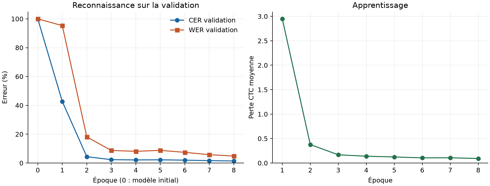

# Résultats : OCR arabe sur RTX 5070

Le checkpoint choisi à l'époque **8** obtient un **CER de 1,49 %**, un **WER de 6,94 %** et **51,65 % de lignes exactes** sur les **1 212 lignes du test officiel**. Il s'agit d'une expérience sur l'arabe administratif imprimé du Bulletin officiel marocain ; aucune performance en darija n'est mesurée.

## Protocole et matériel

Exécution réelle sur **NVIDIA GeForce RTX 5070 Laptop GPU**, avec 7,93 Gio de mémoire GPU détectée, Python 3.12.10, PyTorch 2.11.0+cu128 et CUDA 12.8. Le modèle CNN + BiLSTM + CTC comporte **1 940 797 paramètres**. Le décodage est glouton, sans modèle de langue. La graine est 42.

| Élément | Mesure enregistrée |
|---|---:|
| Lignes d'entraînement | 10 357 |
| Lignes de validation | 1 160 |
| Lignes de test évaluées | 1 212 |
| Caractères du vocabulaire, sans blanc CTC | 92 |
| Époques terminées | 8 |
| Taille du lot | 16 |
| Hauteur / largeur maximale | 64 / 1600 px |
| AMP float16 | activée |
| Durée entraînement + validation | 581,2 s (9,69 min) |
| Dont entraînement | 556,3 s (9,27 min) |
| Dont validations des époques | 24,9 s (0,41 min) |
| Pic de mémoire CUDA allouée par PyTorch | 0,951 Gio |
| Temps du test | 3,2 s (0,05 min) |
| Débit du test | 380,90 lignes/s |

La durée d'apprentissage additionne les temps d'entraînement et de validation des époques terminées. Elle exclut préparation des données, échauffement CUDA, évaluation initiale et test. Le débit du test inclut lecture et décodage des PNG, prétraitement, calcul du modèle, décodage CTC et métriques ; l'échauffement CUDA est exclu. La mémoire indiquée mesure les allocations PyTorch, pas la mémoire totale utilisée sur la carte.

## Progression et sélection du checkpoint

Le CER de validation passe de **99,95 % avant apprentissage** à **1,40 % au meilleur checkpoint** (98,55 points de pourcentage de diminution). Le WER de validation à cette époque est de 4,84 %.

Le checkpoint est sélectionné uniquement sur le CER de validation. Le test officiel est évalué séparément avec ce checkpoint.

| Époque | Perte CTC entraînement | CER validation | WER validation |
|---:|---:|---:|---:|
| 1 | 2,9506 | 42,65 % | 95,27 % |
| 2 | 0,3775 | 4,39 % | 18,08 % |
| 3 | 0,1679 | 2,32 % | 8,71 % |
| 4 | 0,1390 | 2,14 % | 8,10 % |
| 5 | 0,1234 | 2,21 % | 8,77 % |
| 6 | 0,1059 | 1,98 % | 7,41 % |
| 7 | 0,1070 | 1,65 % | 5,77 % |
| 8 | 0,0920 | 1,40 % | 4,84 % |

## Préparation des données et limites

Source : [Moroccan Official Gazette, Zenodo](https://zenodo.org/records/21702529), DOI 10.5281/zenodo.21702529, licence annoncée CC BY 4.0. Les 1 212 fichiers du test officiel sont exclus du corpus d'apprentissage. La déduplication retire 102 lignes recouvrant le test puis 57 lignes recouvrant la validation. Les doublons sont recherchés par nom, SHA-256 d'image et transcription normalisée. La validation est séparée par groupes de pages.

L'audit compte **0 chevauchement entre splits par nom/image/texte**, mais **4 pages communes entre entraînement et test** et 2 entre validation et test. Des documents sont donc représentés dans plusieurs splits ; ces résultats ne démontrent pas une généralisation à des documents entièrement nouveaux.

Pour **38 fichiers**, la transcription du test officiel diffère de celle de `merged.jsonl`. La transcription officielle est conservée après la même normalisation NFC et réduction des espaces. Les diacritiques, le tatweel et les signes non blancs sont conservés.

**2 exemples sont mis en quarantaine uniquement dans l'entraînement**, après inspection des images ; validation et test restent inchangés :

- `1 (157)__page_001__region_010.png` : Visual inspection: annotation contains dozens of zeros that do not match the date in the crop..
- `1 (183)__page_026__region_001.png` : Visual inspection: crop contains two visual text lines; this recognizer expects one line..

Caractères hors vocabulaire : 0 en validation et 0 au test. Le vocabulaire provient uniquement de l'entraînement.

Le parcours global de droite à gauche des caractéristiques reste une approximation pour les lignes mêlant arabe, chiffres et segments latins. Certains crops contiennent des défauts de scan ou des annotations imparfaites. Les images longues sont comprimées à la largeur maximale indiquée. Une adaptation à la darija demande un jeu représentatif d'images et de transcriptions et une évaluation distincte.

## Exemples de prédictions

Exemples illustratifs choisis mécaniquement aux 40e, 50e et 60e percentiles du CER par ligne après tri de tout le test par CER puis identifiant. Il n'y a pas de sélection manuelle des meilleures lignes. Le CER par ligne sert seulement à ce choix ; les CER et WER du rapport sont calculés sur le corpus entier.

**40e percentile — `1 (153)__page_002__region_014.png` — CER ligne 0,00 %**

Référence :

> وبهذا الخصوص ولتفادي عدم قانونية وعدم شرعية تدبير الهيآت المذكورة للوحدات الصحية بعد فاتح يناير

Prédiction :

> وبهذا الخصوص ولتفادي عدم قانونية وعدم شرعية تدبير الهيآت المذكورة للوحدات الصحية بعد فاتح يناير

**50e percentile — `1 (169)__page_007__region_001_line_0034.png` — CER ligne 0,00 %**

Référence :

> أ- دفع الرسوم والمستحقات؛

Prédiction :

> أ- دفع الرسوم والمستحقات؛

**60e percentile — `1 (11)__page_010__region_005_line_0001.png` — CER ligne 1,05 %**

Référence :

> 4- تطبق مقتضيات الفقرتين 1 و 3 كذلك على الدخل الناتج عن الممتلكات العقارية لمقاولة وكذا على دخل

Prédiction :

> 4- تطبق مقتضيات الفقرتين 1 و3 كذلك على الدخل الناتج عن الممتلكات العقارية لمقاولة وكذا على دخل

Toutes les prédictions : [predictions.jsonl](runs/baseline/test/predictions.jsonl). Métriques complètes : [metrics.json](runs/baseline/test/metrics.json). Configuration : [config.json](runs/baseline/config.json). Audit des données : [data_audit.json](runs/baseline/data_audit.json).

## Vérifications du code

Résultat enregistré : **14 tests réussis**, 0 en échec, 0 ignorés. Détail : [tests_result.json](runs/baseline/tests_result.json).
