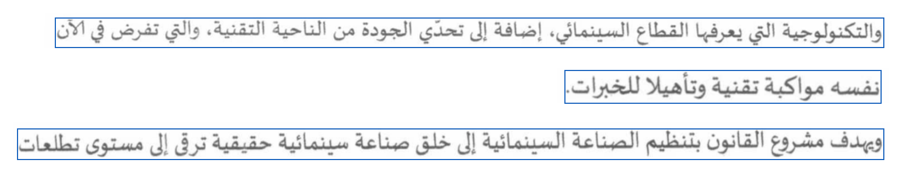

# Comprendre et construire Moroccan Darija OCR

**Cours théorique et technique - CNN, BiLSTM et CTC**

Support en français, fondé sur le code et les expériences du projet au **11 novembre 2026**.
Niveau : bases de Python, puis progression vers l'apprentissage profond appliqué.

## 0. Comment utiliser ce cours

Le but est de pouvoir expliquer une prédiction depuis ses pixels jusqu'au texte, justifier les choix techniques,
reproduire une expérience et identifier ce que les résultats permettent réellement de conclure.

| Parcours | Chapitres | Travail conseillé |
|---|---|---|
| Comprendre le projet | 1 à 4 | Reformuler le problème et préparer une paire image/texte |
| Comprendre le réseau | 5 à 9 | Refaire les dimensions et un exemple CTC à la main |
| Entraîner correctement | 10 à 12 | Lire un journal, contrôler un split et un checkpoint |
| Utiliser et évaluer | 13 à 16 | Lancer la démo et analyser ses limites |
| Se préparer à l'entretien | Annexe et exercices | Répondre sans confondre métrique, capacité et hypothèse |

Lire les exercices dans [EXERCICES_OCR.md](EXERCICES_OCR.md) après chaque thème. La version PDF regroupe le cours
et les corrigés. Les commandes s'exécutent depuis le dossier `arabic_ocr/`, sauf mention contraire.

### Notations de travail

| Symbole | Sens dans le cours |
|---|---|
| x | Image d'une ligne de texte |
| y | Transcription de référence en ordre Unicode logique |
| B | Taille du lot, ou batch |
| H, W | Hauteur et largeur de l'image |
| C | Nombre de canaux d'une carte de caractéristiques |
| T | Nombre de positions temporelles produites par le CNN |
| U | Nombre de caractères de la transcription |
| V | Nombre de caractères dans le vocabulaire, sans le blank |
| h | Taille cachée du LSTM, ici 128 par direction |
| theta | Ensemble des paramètres appris du réseau |

Dans l'OCR, le mot « temporel » désigne ici les positions successives dans la largeur de l'image. Il ne s'agit
pas d'une vidéo. Les formes des tenseurs sont écrites dans leur ordre exact, par exemple `[B, C, H, W]`.

## 1. Le problème : transformer une image en texte

### 1.1 Classification, détection et reconnaissance

Une classification associe une catégorie à une image : « contient du texte » ou « ne contient pas de texte ».
Une détection localise des régions : une ligne, un mot ou un bloc. Une reconnaissance prédit la suite de symboles
contenue dans une région. Notre réseau résout principalement le troisième problème, sur une image de ligne.

Un OCR de page doit combiner localisation, reconnaissance et reconstruction de l'ordre de lecture. Une excellente
reconnaissance ne compense pas une ligne manquante ou un recadrage qui coupe ses points.

```text
Page -> régions/lignes -> images de lignes -> réseau -> textes -> ordre de lecture
```

Le projet contient désormais une segmentation expérimentale de pages simples à une colonne. Cela étend la chaîne
d'utilisation, sans démontrer une bonne lecture de tous les documents, tableaux ou photographies.

### 1.2 Pourquoi l'arabe et la darija demandent de l'attention

Les lettres arabes sont souvent liées et leur forme varie selon le contexte. Des caractères proches se distinguent
par leurs points. Des marques vocaliques peuvent se trouver au-dessus ou au-dessous du corps des lettres.
Un découpage naïf en caractères isolés détruit facilement ces informations.

La darija ajoute des écritures variables et des mélanges de scripts. Un document peut mêler arabe, français,
chiffres et ponctuation. L'Arabizi utilise aussi des chiffres dans des mots latins. Ces caractéristiques influencent
le vocabulaire, le rendu synthétique et l'évaluation ; elles ne demandent pas forcément un CNN entièrement différent.

L'OCR doit transcrire ce qui est visible. Il ne traduit pas automatiquement la darija et ne doit pas réécrire les
variantes orthographiques selon une norme inventée.

### 1.3 Le contrat de supervision

L'exemple d'apprentissage élémentaire est une paire :

```text
une image contenant UNE ligne <-> transcription exacte de cette ligne
```

CTC évite d'annoter la position de chaque caractère. Il faut toujours une transcription alignée à l'ensemble de la
ligne. Fournir l'image d'un paragraphe et sa transcription globale à notre modèle de lignes ne résout pas cette
contrainte : la conversion du CNN en séquence suit surtout l'axe horizontal, pas les retours à la ligne.

## 2. Les données du projet et leur rôle

### 2.1 Quatre ressources, quatre usages

| Ressource | Ce qu'elle apporte | Usage dans ce projet |
|---|---|---|
| Bulletin officiel marocain | Scans de lignes imprimées arabes et textes | Baseline réelle, entraînement et test arabe |
| DODa | Textes Darija, notamment en alphabet arabe | Source de phrases pour produire des images synthétiques |
| AtlasOCR-data | Images et textes Darija, souvent pages ou blocs | Textes train utilisés pour de nouvelles lignes synthétiques |
| AtlasOCRBench | Images et références de test | Benchmark réservé, à évaluer au bon niveau de document |

Un texte réel rendu avec une police sur une nouvelle image produit une **image synthétique**. Son origine textuelle
ne transforme pas cette image en photographie réelle. De même, un dataset disponible publiquement n'est pas
automatiquement exploitable sous n'importe quelle licence : garder ses conditions et son attribution.

Sources des données : [Gazette sur Zenodo](https://zenodo.org/records/21702529),
[DODa](https://github.com/darija-open-dataset/dataset),
[AtlasOCR-data](https://huggingface.co/datasets/atlasia/atlasOCR-data) et
[AtlasOCRBench](https://huggingface.co/datasets/atlasia/AtlasOCRBench).

### 2.2 Le format JSONL

JSONL contient un objet JSON par ligne. Il est facile à inspecter et conserve des métadonnées de provenance.

```json
{"id":"ligne_001","image":"images/ligne_001.png","text":"سلام","source_row_idx":7,"synthetic":true}
```

`image` identifie les pixels ; `text` la cible ; `id` l'exemple. `source_row_idx`, `source_dataset` et `split_group`
servent à retrouver les segments qui viennent de la même source. Leur présence permet un audit ultérieur.
Dans les sorties validées, les chemins sont généralement absolus. Après déplacement du corpus, les régénérer.

### 2.3 Train, validation, test : trois responsabilités

Train sert à calculer les gradients. Validation sert à choisir un checkpoint et à régler les hyperparamètres.
Test sert à estimer la performance finale du système sélectionné. Si les erreurs du test guident continuellement
les décisions, ce test devient indirectement un jeu de développement.

La séparation doit se faire au niveau de la source pertinente **avant** de dériver les lignes. Si deux lignes
proviennent de la même page, elles peuvent partager police, scanner, mise en page et contenu. Des splits sans
images identiques peuvent donc rester dépendants.

Le SHA-256 détecte des fichiers binaires identiques. Il ne détecte pas à lui seul une copie redimensionnée, une autre
compression, une photographie du même texte ou deux crops d'une même page. La provenance complète ce contrôle.

### 2.4 Les contrôles actuellement ajoutés

Le générateur garde les segments d'une même ligne source Atlas dans un même split. La séparation utilise un RNG
distinct de celui du rendu. L'augmentation concerne le train ; à corpus, polices et graine fixes, la validation
garde les mêmes images. La fusion contrôle les textes normalisés et les hashes d'image entre les splits.

Cette correction concerne les **nouvelles générations**. Les anciens corpus ne deviennent pas indépendants parce
que le code a été corrigé : il faut les régénérer, puis réentraîner les modèles concernés.

## 3. Unicode, typographie arabe et rendu synthétique

### 3.1 Ordre logique et ordre visuel

Un texte est stocké comme une suite de points de code Unicode. Son affichage applique ensuite des règles
bidirectionnelles et typographiques. L'ordre en mémoire et l'ordre des glyphes visibles sont deux notions différentes.

Les labels de notre réseau restent en ordre logique. On ne leur applique pas de « retournement graphique » avant
CTC. Les bibliothèques de shaping/bidi servent au rendu de nouvelles images, pas à transformer arbitrairement les
références du modèle. Les règles d'affichage sont définies dans [Unicode UAX #9](https://www.unicode.org/reports/tr9/).

### 3.2 Normaliser sans effacer le problème

NFC rapproche certaines représentations Unicode équivalentes. Réduire les espaces successifs harmonise le format.
Cela ne signifie pas supprimer les accents, les points ou les marques vocaliques.

La politique choisie doit être commune aux données, au vocabulaire et aux métriques. Retirer des signes seulement
dans les prédictions peut améliorer artificiellement un score. Si une mesure « sans diacritiques » est utile,
la publier comme métrique supplémentaire avec sa règle explicite, à côté de la mesure stricte.

Le CER actuel compte les points de code Python, pas les graphèmes visuels : une lettre et sa marque combinante
peuvent compter comme deux unités. Un glyphe de ligature peut représenter plusieurs caractères cibles.

### 3.3 Produire une image fidèle à sa cible

Une génération correcte nécessite du texte, une police qui couvre ses caractères et un moteur de mise en forme.
Le code préfère Pillow avec RAQM quand disponible. Sinon, il emploie `arabic_reshaper` et `python-bidi` avec une
configuration qui conserve les harakat.

Une erreur historique du projet supprimait ces marques dans l'image tout en les conservant dans la cible.
Le modèle devait alors prédire des signes parfois invisibles. La correction évite cette incohérence pour les
nouvelles images. Elle ne garantit pas que chaque police couvre toutes les lettres étrangères : vérifier les
glyphes absents et quelques exemples rendus avant d'entraîner tout un corpus.

### 3.4 L'écart synthétique/réel

Un rendu propre simplifie le fond, l'éclairage, l'inclinaison et les défauts du scanner. Un modèle peut apprendre
très vite ces images puis échouer sur une photographie réelle : les distributions d'entrée diffèrent.

Le bruit, le contraste, la rotation et le flou peuvent élargir la variété visuelle. Leur effet doit être mesuré
sur une validation fixe. Une dégradation excessive peut aussi masquer les points et rendre la cible illisible.
L'augmentation est une hypothèse expérimentale, pas une amélioration garantie.

## 4. Prétraitement et construction des lots

### 4.1 Du fichier au tableau de pixels

`data.preprocess()` corrige l'orientation EXIF, compose les transparences sur fond blanc et convertit l'image en
niveaux de gris. Il fixe la hauteur à 64 pixels dans les expériences principales et conserve le rapport largeur/hauteur
jusqu'au plafond de 1 600 pixels.

```text
W_ratio = arrondi(W_original * 64 / H_original)
W_clip  = max(16, min(1600, W_ratio))
W_final = 4 * plafond(W_clip / 4)
```

Le plafond est divisible par quatre dans la configuration d'entraînement. L'arrondi simplifie la correspondance
avec le sous-échantillonnage horizontal du CNN. Une ligne trop longue est comprimée : des détails peuvent disparaître.
Une augmentation de la largeur maximale consomme plus de mémoire et allonge les séquences du BiLSTM.

### 4.2 Normalisation des valeurs

Le chargement conserve des pixels entiers de 0 à 255. `collate_lines()` crée ensuite un tenseur flottant :

```text
x = 1 - pixels / 255
```

Le blanc devient 0 et le noir 1. Le padding droit vaut également 0 : il correspond donc au fond blanc. Ce choix
diffère d'un centrage statistique autour d'une moyenne ; il faut le reproduire exactement lors de l'inférence.

### 4.3 Largeurs variables et padding

Les images d'un lot doivent partager une forme. On complète à droite les images les plus courtes jusqu'à la largeur
maximale du lot, tout en gardant leur vraie largeur dans `widths`.

```text
Image A : largeur valide 400, lot de largeur 800
Image B : largeur valide 800, lot de largeur 800
Après CNN : longueurs valides 100 et 200
```

Le regroupement de largeurs proches réduit les calculs inutiles sur le fond. Le packing du BiLSTM évite de traiter
les positions de padding comme du texte. Le CNN a néanmoins des effets de bord et un contexte local : le packing
du RNN ne prouve pas une invariance absolue de toute la chaîne à n'importe quel padding.

Le prétraitement dépend des pixels et de la configuration, jamais de la transcription attendue. Redimensionner une
image selon la longueur de sa réponse créerait un raccourci indisponible en utilisation réelle.

## 5. Le CNN : apprendre une représentation visuelle

### 5.1 Pourquoi une convolution ?

Une convolution applique un filtre sur des voisinages de l'image. Les mêmes poids sont utilisés à plusieurs positions.
Cela permet d'apprendre des motifs locaux : contours, points, segments et combinaisons de traits.

Pour une position donnée, on calcule une somme pondérée des pixels/features voisins. Pendant la rétropropagation,
les filtres changent pour rendre la transcription plus probable. On ne programme pas manuellement un filtre par lettre.

```text
Sortie(c, i, j) = somme sur les canaux et positions du noyau
                 de poids(c, ...) * entree(...)
```

Dans ce projet, les convolutions ont un noyau 3 par 3, un padding de 1 et pas de biais. À stride 1, elles conservent
la hauteur et la largeur. Les changements de taille spatiale viennent ici principalement des max-poolings.

### 5.2 BatchNorm, ReLU et pooling

BatchNorm normalise les activations par canal en entraînement, puis utilise des statistiques stockées en évaluation.
Elle possède aussi des paramètres appris. Cela explique pourquoi `model.eval()` est important en inférence.

ReLU conserve la partie positive d'une activation : `ReLU(a) = max(0, a)`. Elle introduit une non-linéarité ; sans
non-linéarités, une succession de transformations linéaires resterait globalement linéaire.

MaxPool sélectionne une valeur maximale dans chaque petite fenêtre. Il réduit la résolution et le coût, mais peut
éliminer des détails. On réduit donc moins la largeur que la hauteur : le CTC a besoin d'assez de positions pour
aligner les caractères.

### 5.3 Architecture réellement implémentée

Il y a **quatre blocs et six convolutions**. Les deux derniers blocs contiennent chacun deux convolutions.
Avec `channels=32`, les sorties des blocs ont 32, 64, 128 puis 256 canaux.

| Étape | Opération spatiale | Forme pour une entrée de largeur 800 |
|---|---|---|
| Entrée | Niveau de gris | `[B, 1, 64, 800]` |
| Bloc 1 | Conv, BN, ReLU, pool 2x2 | `[B, 32, 32, 400]` |
| Bloc 2 | Conv, BN, ReLU, pool 2x2 | `[B, 64, 16, 200]` |
| Bloc 3 | Deux Conv/BN/ReLU, pool 2x1 | `[B, 128, 8, 200]` |
| Bloc 4 | Deux Conv/BN/ReLU, pool 2x1 | `[B, 256, 4, 200]` |
| Moyenne sur la hauteur | `mean(dim=2)` | `[B, 256, 200]` |
| Transposition | Temps avant canaux | `[B, 200, 256]` |

Le facteur horizontal total est 4 ; le facteur vertical est 16. En général, `T = plancher(W / 4)` pour la vraie
largeur fournie au modèle. Les configurations du projet arrondissent cette largeur au multiple de quatre supérieur.

### 5.4 Ce qu'une feature n'est pas

Les 256 valeurs d'une position temporelle ne sont pas 256 probabilités de caractères. Elles décrivent un contexte
visuel appris. Une position CNN n'est pas non plus « un caractère » : plusieurs positions peuvent décrire la même
lettre, et une position a un champ réceptif qui couvre plusieurs colonnes d'image.

Cette transformation image -> séquence suit l'idée des architectures CRNN. Le projet en est une implémentation
compacte adaptée aux lignes arabes, pas une copie exacte de tous les détails de l'article
[Shi, Bai et Yao](https://arxiv.org/abs/1507.05717).

### 5.5 Compter les paramètres pour comprendre le coût

Une convolution sans biais possède `C_sortie * C_entree * k_h * k_w` poids. Une BatchNorm affine ajoute deux
paramètres appris par canal ; ses statistiques courantes ne sont pas des paramètres optimisés. En appliquant ces
comptes aux six convolutions, le CNN du projet contient 1 126 368 paramètres appris.

Pour une couche LSTM PyTorch d'entrée `d` et de taille cachée `h`, par direction, le nombre de paramètres est :

```text
4*h*d + 4*h*h + 8*h = 4*h*(d + h + 2)
```

Il y a quatre portes et deux vecteurs de biais dans l'implémentation. Avec `d=256` et `h=128`, on obtient 197 632
paramètres par direction, 395 264 pour une couche bidirectionnelle et 790 528 pour les deux couches utilisées ici.
La seconde reçoit elle aussi 256 features, donc le même compte s'applique.

La projection finale contient `(256+1)*(V+1)` paramètres. Pour V=92 : 23 901. Le total du baseline est ainsi
`1 126 368 + 790 528 + 23 901 = 1 940 797`. Étendre le vocabulaire à 200 caractères porte le total à 1 968 553.
Le nombre de paramètres n'exprime pas à lui seul le coût du traitement : une ligne deux fois plus large augmente
les calculs et les activations même avec exactement les mêmes poids.

## 6. Du RNN au BiLSTM

### 6.1 Pourquoi ajouter un modèle séquentiel ?

Un motif ambigu se comprend mieux grâce à son voisinage. Le RNN réutilise un état caché pour transmettre une
information d'une position à l'autre. Un RNN simple s'écrit schématiquement :

```text
h_t = tanh(W_x * x_t + W_h * h_(t-1) + b)
```

Lors de la rétropropagation, les gradients traversent de nombreuses étapes. Des produits répétés peuvent devenir
très petits ou très grands. Le LSTM ajoute une mémoire et des portes pour faciliter le contrôle de cette propagation.
Il atténue certains problèmes de dépendance longue ; il ne les rend pas impossibles.

### 6.2 Les portes du LSTM

À chaque position, le LSTM combine la feature courante, son état caché précédent et sa mémoire précédente.
Une écriture standard est :

```text
i_t = sigmoid(W_i x_t + U_i h_(t-1) + b_i)
f_t = sigmoid(W_f x_t + U_f h_(t-1) + b_f)
g_t = tanh(W_g x_t + U_g h_(t-1) + b_g)
o_t = sigmoid(W_o x_t + U_o h_(t-1) + b_o)
c_t = f_t * c_(t-1) + i_t * g_t
h_t = o_t * tanh(c_t)
```

Les multiplications entre portes et mémoires sont élément par élément. `i` règle l'écriture, `f` la conservation,
`g` le contenu proposé et `o` la sortie visible. Les noms « oubli » et « mémoire » sont des analogies de calcul,
pas des opérations conscientes ou une base de données de mots.

### 6.3 Bidirectionnel et deux couches

Un BiLSTM parcourt la séquence dans les deux directions, puis concatène leurs sorties. Il peut utiliser le contexte
des deux côtés parce qu'une image de ligne complète est disponible au moment de sa lecture.

Ici, chaque direction a 128 unités. La concaténation donne 256 features par position. La deuxième couche reçoit les
sorties de la première. Le dropout de 0,1 concerne les connexions entre couches du LSTM ; ce n'est pas un dropout
placé après chaque convolution. Voir la signature du module dans `model.py` et la
[référence LSTM de PyTorch 2.11](https://docs.pytorch.org/docs/2.11/generated/torch.nn.LSTM.html).

### 6.4 RTL et séquences de largeur variable

Le code garde l'image dans son orientation visuelle normale. Il inverse uniquement l'axe des features CNN valides
avant le BiLSTM, pour favoriser un alignement avec des labels arabes en ordre logique.

```text
Features valides : A B C | padding
Après inversion : C B A | positions non utilisées par le RNN
```

`pack_padded_sequence()` utilise les vraies longueurs. La partie au-delà de ces longueurs ne devient pas une lettre
en tête de séquence. Au décodage aussi, les positions au-delà de la longueur valide sont ignorées.

Cette inversion globale reste une approximation pour une ligne arabe mêlée de chiffres et de français : ces segments
ne suivent pas tous la même direction visuelle. Le BiLSTM ne remplace pas à lui seul l'algorithme Unicode bidi.

## 7. Projection en caractères et probabilités

La couche linéaire transforme les 256 features séquentielles en scores, ou logits, pour chaque caractère et le blank.

```text
z_t = W_sortie * h_t + b_sortie
nombre de scores à chaque position = V + 1
```

Le baseline possède 92 caractères et donc 93 classes. L'indice 0 est le blank CTC ; le premier caractère de la liste
`characters` correspond à la classe 1. L'espace typographique, s'il appartient au vocabulaire, possède sa propre
classe : **espace et blank sont différents**.

La softmax convertit les scores en une distribution par position :

```text
p_t(k) = exp(z_t(k)) / somme_j exp(z_t(j))
```

Le réseau retourne directement `log_softmax` en float32. Il fournit donc des **log-probabilités**, pas des
probabilités ordinaires et pas les logits bruts. Le format final attendu par CTC est `[T, B, V+1]`.

Pour l'exemple de largeur 800 : `[200, B, 93]` avec le vocabulaire du baseline. Les sorties sont des distributions
sur des symboles, pas une confiance calibrée de la ligne entière. La démo actuelle ne calcule pas de score de
confiance calibré.

## 8. CTC : apprendre sans annoter chaque caractère

### 8.1 Pourquoi une classification par position ne suffit pas

L'image peut produire 200 positions CNN et le texte contenir 40 caractères. On ne connaît pas exactement la position
du premier caractère, sa durée visuelle ni le nombre de positions à lui attribuer. Une loss classique qui exige une
étiquette à chaque position demanderait un alignement supplémentaire.

CTC, Connectionist Temporal Classification, considère plusieurs alignements possibles entre les deux séquences.
Son objectif optimise leur probabilité totale. Le mécanisme de somme d'alignements vient de
[Graves et ses coauteurs](https://www.cs.toronto.edu/~graves/icml_2006.pdf).

### 8.2 Un chemin et son collapse

Un chemin contient un symbole par position, y compris des blanks. On note le blank `_` dans les exemples suivants.
Pour transformer un chemin en texte, on fusionne d'abord les répétitions **consécutives**, puis on supprime les blanks.

```text
Chemin : a a _ a b b _
Fusion : a   _ a b   _
Texte  : a a b

B(a a _ a b b _) = aab
```

Supprimer d'abord les blanks donnerait `aaabb`, puis une fusion incorrecte en `ab`. L'ordre des opérations est donc
essentiel. Pour produire deux `l` consécutifs, un blank doit les séparer dans le chemin, par exemple `l _ l`.

### 8.3 Somme des probabilités d'alignement

Sous la factorisation utilisée par CTC, la probabilité d'un chemin `pi` est le produit des probabilités à ses positions :

```text
P(pi | x) = produit_t p_t(pi_t)
P(y | x)  = somme des P(pi | x) pour les chemins dont B(pi) = y
L_CTC(x,y) = -log P(y | x)
```

Le BiLSTM fournit du contexte à chaque position ; la factorisation CTC ne signifie donc pas que le réseau ignore
les voisins. Elle décrit comment on combine les probabilités de sortie pour un alignement donné.

Exemple calculable : deux positions, alphabet `{a, blank}`, avec la probabilité de `a` égale à 0,6 à chaque position.
Les chemins qui donnent `a` sont `(a,a)`, `(a,_)` et `(_,a)` :

```text
P(a | x) = 0.6*0.6 + 0.6*0.4 + 0.4*0.6 = 0.84
L_CTC   = -log(0.84), environ 0.1744
```

Le chemin `(_,_)` donne un texte vide ; il ne contribue pas à cette cible. Avec seulement deux positions, la cible
`aa` est impossible : il faudrait au minimum le chemin `a _ a`.

### 8.4 Comment calculer la somme efficacement

Énumérer tous les chemins coûterait exponentiellement en T. Une programmation dynamique réutilise les sommes
partielles. On insère des blanks entre les caractères de la cible et aux deux extrémités :

```text
Cible : ab
Cible étendue : _ a _ b _
```

Une variable `alpha(t,s)` représente la masse des chemins qui atteignent l'état `s` à la position `t`.
Elle reçoit les contributions du même état, de l'état précédent et, lorsque le symbole et les règles de répétition
le permettent, d'un saut de deux états. Chaque somme est multipliée par la probabilité du symbole de l'état courant.
On initialise les premiers états accessibles et somme les états terminaux valides.

L'ordre de grandeur du coût de cette récurrence est `O(T * U)`. En pratique, les calculs utilisent des formulations
numériquement stables en log-espace. Le projet délègue cette opération et sa différentiation à `torch.nn.CTCLoss`.

Pour aller plus loin, numéroter la cible étendue de 1 à `S=2*U+1`. En posant les états inexistants à zéro, la
récurrence avant peut s'écrire :

```text
alpha[t,s] = p_t(y_prime[s]) * (
    alpha[t-1,s] + alpha[t-1,s-1]
    + saut_autorise(s) * alpha[t-1,s-2]
)
```

Le saut vaut 1 seulement si `s>2`, si le symbole courant n'est pas blank et s'il diffère du symbole deux états avant.
On initialise `alpha[1,1]` avec la probabilité du blank et `alpha[1,2]` avec celle du premier caractère. Les autres
états commencent à zéro. Pour une cible non vide, `P(y|x) = alpha[T,S] + alpha[T,S-1]`.

Exemple : avec la cible `aa`, on ne peut pas sauter directement du premier `a` au second : le blank intermédiaire
doit être traversé. Cette règle explique la contrainte supplémentaire liée aux répétitions.

### 8.5 La condition de faisabilité

Si la cible comporte `U` caractères et `R` paires adjacentes identiques, une condition nécessaire minimale est :

```text
T >= U + R
R = nombre de positions i telles que y[i] == y[i+1]
```

Notre architecture donne `T = plancher(W/4)`. La cible `لل` contient deux caractères et une répétition adjacente :
elle demande au moins trois positions, donc une largeur réseau d'au moins 12 pixels sur ce seul critère. Les
prétraitements imposent aussi leur propre largeur minimale et la lisibilité reste nécessaire.

`assert_ctc_feasible()` vérifie cette contrainte. Un `T` suffisant ne garantit pas une image lisible ou un bon modèle.
Une image trop comprimée peut être formellement compatible tout en perdant ses détails.

### 8.6 La réduction exacte de la loss

Dans le projet, `CTCLoss(blank=0, reduction="mean", zero_infinity=False)` divise les pertes individuelles par la
longueur de leur cible, puis fait une moyenne du batch. La valeur affichée n'est donc pas simplement la moyenne
des `-log P(y|x)` bruts.

Les pertes infinies ne sont pas silencieusement mises à zéro. Le code vérifie la faisabilité et les valeurs finies.
Une loss infinie ou NaN demande un diagnostic de données, dimensions ou stabilité numérique. La signature et les
règles de réduction sont précisées dans la [documentation CTCLoss 2.11](https://docs.pytorch.org/docs/2.11/generated/torch.nn.CTCLoss.html).

## 9. Décoder le texte à l'inférence

### 9.1 Décodage glouton

À chaque position valide, `greedy_decode()` choisit la classe la plus probable. Il fusionne les répétitions adjacentes
et retire le blank, tout en ignorant le padding. C'est rapide et déterministe pour des scores fixés.

Cette méthode sélectionne le meilleur **chemin** position par position. Plusieurs chemins peuvent contribuer au
même texte : le texte issu du meilleur chemin n'est donc pas nécessairement celui dont la probabilité totale est
la plus grande. C'est la différence entre maximiser un chemin et sommer les chemins par transcription.

### 9.2 Beam search et modèle de langue

Un beam search conserve plusieurs préfixes candidats au lieu d'un choix unique. Un modèle de langue peut favoriser
les suites plausibles, au prix de calculs supplémentaires et d'un risque de corriger à tort des noms propres ou des
variantes Darija.

Ces techniques sont des extensions possibles : le projet utilise actuellement un décodage glouton, sans lexique
contraignant, sans modèle de langue et sans correction linguistique automatique. En entretien, ne pas annoncer
ces options comme si elles étaient déjà implémentées.

### 9.3 Deux réglages différents pour l'inférence

`model.eval()` modifie le comportement de BatchNorm et du dropout : les statistiques stockées sont utilisées et
le dropout est désactivé. `torch.inference_mode()` désactive le suivi nécessaire à l'autograd et réduit son coût.
Le premier ne remplace pas le second. On utilise les deux pour une reconnaissance reproductible et sans calcul
inutile de gradients. Cela ne modifie ni le vocabulaire ni la signification du blank.

## 10. Entraîner le réseau et exploiter la RTX 5070

### 10.1 Un exemple, un batch et une époque

Un exemple correspond à une ligne. Un batch regroupe plusieurs lignes. Une époque parcourt l'ensemble d'apprentissage,
sauf limites explicites comme `--max-steps`. Un pas d'optimisation met à jour les poids à partir des gradients d'un batch.

Avec 4 500 lignes et un batch de 16, un passage contient normalement `plafond(4500/16) = 282` batches. Le dernier
peut être incomplet. Des pas sautés lors d'un overflow AMP expliquent parfois moins d'exemples effectivement optimisés.

### 10.2 La boucle essentielle

```python
optimizer.zero_grad(set_to_none=True)
with torch.autocast(device.type, dtype=torch.float16, enabled=amp):
    log_probs, input_lengths = model(images, widths)
loss = criterion(log_probs.float(), targets, input_lengths, target_lengths)
scaler.scale(loss).backward()
scaler.unscale_(optimizer)
torch.nn.utils.clip_grad_norm_(model.parameters(), 5.0)
scaler.step(optimizer)
scaler.update()
```

Le forward calcule les scores, la loss évalue leur compatibilité avec les références, `backward()` calcule les gradients
et l'optimiseur modifie les paramètres. Les références ne sont pas fournies au réseau comme une entrée au moment
de la reconnaissance.

### 10.3 AdamW, learning rate et régularisation

AdamW adapte les mises à jour avec des statistiques de gradients et applique une décroissance des poids séparée.
Le projet utilise un `weight_decay` de `1e-4`. Le learning rate règle l'amplitude des mises à jour : trop grand,
il peut déstabiliser le fine-tuning ; trop petit, il peut ralentir l'apprentissage.

La rétropropagation applique la règle de dérivation des fonctions composées : une influence de la loss sur une
feature se propage vers les poids qui ont produit cette feature. Les poids du CNN reçoivent donc leur gradient via
la projection, le BiLSTM et CTC, sans cible intermédiaire imposée aux filtres.

Pour un gradient `g_t`, Adam maintient des moyennes mobiles de `g_t` et de son carré. Après correction du biais
initial de ces moyennes, la mise à jour utilise un gradient normalisé, et AdamW ajoute une décroissance séparée :

```text
m_t = beta1*m_(t-1) + (1-beta1)*g_t
v_t = beta2*v_(t-1) + (1-beta2)*g_t*g_t
m_corr = m_t / (1-beta1^t)
v_corr = v_t / (1-beta2^t)
theta <- (1-lr*lambda)*theta
         - lr*m_corr/(sqrt(v_corr)+epsilon)
```

Ces opérations sont élément par élément, à l'exception des décisions globales comme le clipping. `lambda` désigne
ici le weight decay. Cette écriture présente le principe, pas l'ensemble des détails d'exécution optimisée du framework.

Le dropout et le weight decay limitent certaines formes de surapprentissage, mais ne corrigent pas un test contaminé.
Le gradient clipping limite la norme globale des gradients à 5 dans la boucle. Il doit agir **après** le retrait
du facteur d'échelle AMP, sinon le seuil ne correspond pas à la vraie norme.

### 10.4 AMP et stabilité numérique

Le CNN et le BiLSTM peuvent utiliser des opérations float16 sur CUDA, alors que les log-probabilités/CTC restent en
float32. `GradScaler` amplifie temporairement la loss pour limiter les gradients trop petits en float16, puis retire
ce facteur avant la mise à jour. Il peut sauter un pas lors d'un overflow.

Une précision mixte réduit souvent coût et mémoire, sans garantir un gain identique pour tous les modèles.
`--no-amp` permet de la désactiver. La procédure `unscale_` puis clipping est également illustrée dans les
[exemples AMP officiels](https://docs.pytorch.org/docs/2.11/notes/amp_examples.html).

### 10.5 Scheduler et sélection du meilleur modèle

Le scheduler `ReduceLROnPlateau` surveille le CER de validation, avec facteur 0,5 et patience 2. Une baisse de la
loss train ne suffit pas pour retenir un checkpoint ; le projet sauvegarde `best.pt` selon le CER de validation.
`last.pt` permet de reprendre l'état le plus récent.

Le code actuel n'a pas d'early stopping automatique : la sélection du meilleur checkpoint et la réduction du LR
ne signifient pas arrêt anticipé. On choisit le nombre d'époques à exécuter, puis on conserve le meilleur modèle observé.

### 10.6 Ce qui consomme la mémoire GPU

La mémoire contient poids, gradients, états de l'optimiseur et activations. Pour un CNN, les cartes intermédiaires
peuvent coûter bien plus que le seul tenseur d'entrée. Pour le BiLSTM, la longueur T compte aussi.

En cas d'OOM : réduire d'abord le batch, contrôler les largeurs et les dimensions de page, vérifier les lots et
les copies de checkpoints. L'inférence de pages utilise maintenant des lots bornés au lieu d'envoyer toutes les
lignes simultanément. Le chargement d'inférence lit le checkpoint sur CPU avant de déplacer le réseau sur le GPU.

Le GPU des expériences est une **RTX 5070 Laptop**, avec environ 8 Go de mémoire détectés. On ne peut pas transposer
directement ses débits à toutes les RTX 5070 ni à tous les types de documents.

## 11. Fine-tuning, checkpoints et reproductibilité

### 11.1 Réutiliser le modèle arabe

Le CNN apprend des motifs graphiques et le BiLSTM une représentation séquentielle utile à l'arabe imprimé.
Le fine-tuning reprend ces poids plutôt que d'initialiser tout le réseau aléatoirement. Toutes les couches peuvent
être mises à jour dans l'entraînement actuel ; le CNN n'est pas gelé par défaut.

Mélanger des lignes arabes réelles avec des lignes Darija synthétiques peut aider à conserver les capacités de base.
Cela ne prouve pas automatiquement un gain Darija réel. Le ratio des sources, leurs styles et leurs fréquences de
caractères doivent être contrôlés et évalués séparément.

### 11.2 Étendre le vocabulaire sans décaler les classes

Dans `adapt.py`, le vocabulaire cible doit contenir les caractères du modèle de base. On crée un nouveau classifieur,
copie la ligne du blank et retrouve chaque ancien caractère par sa valeur Unicode pour copier ses poids.
Les nouveaux caractères gardent leur initialisation fraîche.

Il ne suffit pas de recopier les premières lignes d'une matrice : un tri différent de l'alphabet changerait la
correspondance caractère/indice. Pour un ancien vocabulaire de 92 et un nouveau de 200 caractères, les tailles des
classifieurs sont respectivement 93 et 201 sorties, blank compris.

### 11.3 Ce que contient un checkpoint

`best.pt`/`last.pt` stockent les poids, le vocabulaire, la configuration, l'époque, le meilleur CER, les états de
l'optimiseur, du scheduler et du scaler, ainsi que des états aléatoires. Un poids seul permet l'inférence avec la
bonne architecture ; une reprise fidèle nécessite davantage d'états.

Le script compare vocabulaire, dimensions, graine et hashes de manifests lors d'une reprise. La graine facilite
la répétition, sans garantir une identité bit à bit entre bibliothèques, GPU et versions différents.

Le chargement historique utilise `weights_only=False` parce que le fichier inclut des états Python. Charger uniquement
des fichiers de confiance ; pour une distribution plus simple, une future exportation des poids seuls pourra être étudiée.

### 11.4 Le piège du learning rate restauré

Le script crée d'abord un optimiseur avec le LR demandé, puis restaure l'état du checkpoint si `--resume` est fourni.
Le LR restauré peut donc remplacer la valeur CLI. Dans l'expérience mixte historique, la commande demandait 0,0005,
mais l'historique enregistre 0,001.

Pour décrire une expérience, lire les valeurs réellement appliquées dans `history.jsonl`, pas seulement la commande
lancée. Si l'on souhaite changer le LR en reprise, l'implémenter explicitement après chargement et enregistrer ce choix.

## 12. Mesurer correctement : CER, WER et exactitude

### 12.1 La distance d'édition

La distance de Levenshtein compte le coût minimal de substitutions, suppressions et insertions pour transformer une
référence en prédiction, avec un coût de 1 par opération. Le même principe s'applique à des caractères ou à des mots.

```text
reference : chat
prediction: chats
distance = 1 insertion
CER = 1 / 4 = 25 %
```

En caractères, les espaces et la ponctuation sont inclus dans la mesure du projet. En mots, les chaînes sont
découpées par `split()` ; ce WER dépend donc de la façon dont les mots sont espacés dans les labels.

### 12.2 Les formules au niveau du corpus

```text
CER = somme des erreurs caracteres / somme des caracteres de reference
WER = somme des erreurs mots / somme des mots de reference
Exactitude = lignes strictement identiques / nombre total de lignes
```

Le calcul est micro-moyenné. Il ne fait pas la moyenne des CER individuels, qui donnerait le même poids à une ligne
d'un caractère et à une ligne de cent caractères. Exemple : une erreur sur 2 caractères, aucune sur 100 donne
un CER corpus `1/102`, environ 0,98 %, et non `(50 % + 0 %)/2 = 25 %`.

CER et WER peuvent dépasser 100 % si les insertions sont nombreuses. Ils ne sont pas des probabilités bornées.
`100 - CER` n'est pas l'exactitude des lignes. Un seul accent incorrect suffit à rendre une ligne non exacte.

### 12.3 Interpréter les résultats enregistrés

| Expérience historique | Jeu mesuré | CER | WER | Lignes exactes |
|---|---|---:|---:|---:|
| Baseline arabe | 1 212 lignes du test Gazette | 1,49 % | 6,94 % | 51,65 % |
| Atlas filtré synthétique | 533 lignes de validation synthétique | 6,63 % | 15,01 % | 15,20 % |
| Fine-tuning mixte | 1 685 lignes de validation mixte | 2,20 % | 5,31 % | 64,93 % |
| Checkpoint mixte | Test Gazette officiel | 1,13 % | 5,44 % | 57,84 % |

Le tableau décrit les expériences stockées, pas une nouvelle évaluation réalisée pour ce cours. Les jeux et
domaines diffèrent ; comparer directement toutes les lignes du tableau ne classe pas des modèles sur une même tâche.

L'audit a identifié des segments d'une même source Atlas dans train et validation mixtes, des changements de validation
entre essais d'augmentation et des harakat absents des images historiques. Les métriques synthétiques/mixte restent
exploratoires. Le test Gazette a aussi des pages représentées dans train ; il ne prouve pas la généralisation à des
documents entièrement nouveaux. Voir [EXPERIMENT_AUDIT.md](EXPERIMENT_AUDIT.md) et le README de préparation.

### 12.4 Évaluer les systèmes, pas seulement un chiffre

Pour une page, calculer la qualité de la transcription reconstruite. Un CER de lignes calculé seulement sur les
lignes correctement détectées ignorerait les lignes manquées et serait optimiste. Fixer aussi les règles de jointure,
les espaces, les retours à la ligne et l'ordre de lecture avant d'évaluer.

Mesurer séparément arabe imprimé réel, Darija synthétique et Darija réelle. Afficher des erreurs sur les chiffres,
les noms, les diacritiques et les scripts mixtes. Pour une comparaison sérieuse, utiliser mêmes sources réservées,
même normalisation, même protocole et plusieurs graines si les ressources le permettent.

Le débit dépend du chargement, du prétraitement, des largeurs et du batching. Les mesures du projet incluent aussi
le décodage et les métriques, après un échauffement CUDA. Une capture de mémoire allouée par PyTorch ne décrit pas
à elle seule toute la mémoire occupée visible dans `nvidia-smi`.

### 12.5 Lire les courbes d'apprentissage

Une baisse de la loss train montre que l'objectif sur les exemples vus est mieux optimisé. Si le CER de validation
cesse de diminuer, cela peut signaler du surapprentissage, un écart de domaine ou une limite des labels ; inspecter
des exemples avant de trancher. Le script enregistre la loss CTC train et les métriques de validation, mais ne
calcule pas automatiquement un CER train complet à chaque époque.

La loss CTC et le CER n'ont pas les mêmes unités. On peut les tracer sur des panneaux séparés, sans interpréter
leur différence numérique comme un écart de généralisation. Comparer aussi un nombre suffisant de pas et garder
le même jeu de validation lorsque l'on change un hyperparamètre.

## 13. Passer d'une page à des lignes

### 13.1 Segmentation par projection horizontale

`page_layout.py` transforme la page en niveaux de gris, estime un seuil inspiré d'Otsu et compte les pixels sombres
par ligne horizontale. Des bandes actives séparées par suffisamment de blanc deviennent des candidates.

```text
projection(y) = nombre de pixels sombres sur la ligne horizontale y
```

Les pixels isolés sont filtrés ; certaines petites bandes de diacritiques proches d'un corps de texte sont regroupées.
Des marges sont ajoutées et les limites horizontales sont resserrées. Le seuil d'Otsu est borné dans l'implémentation :
il ne s'agit pas d'un algorithme universel de séparation texte/fond pour toutes les photographies.

### 13.2 Coordonnées, orientation et ordre

Chaque boîte suit `[gauche, haut, droite, bas]`, avec droite et bas exclusives. Les coordonnées concernent l'image
après correction EXIF. Dans une page simple, les lignes sont reconnues de haut en bas et les textes joints avec
un retour à la ligne.



Cette illustration provient d'un contrôle fonctionnel avec trois lignes du train Gazette assemblées. Elle montre
les recadrages produits ; elle ne constitue pas un test indépendant de pages réelles.

### 13.3 Limites de la méthode

Deux colonnes à la même hauteur peuvent être fusionnées dans une seule bande. Les filets de tableau peuvent être
pris pour de l'encre. Le skew rapproche les rangées, et des caractères qui se touchent verticalement fusionnent
des lignes. Un logo ou une ombre peut perturber la projection.

Pour dépasser ces limites, étudier un détecteur de lignes/régions et un modèle d'ordre de lecture. Il faut ensuite
évaluer le pipeline complet. Une simple limite de hauteur dans un validateur ne prouve jamais qu'une image contient
exactement une ligne visuelle.

## 14. Lire le dépôt et exécuter un premier TP

### 14.1 La carte des modules

| Fichier | Responsabilité à comprendre |
|---|---|
| `model.py` | Blocs CNN, BiLSTM, projection et collapse CTC |
| `data.py` | Images, vocabulaire, batch et longueurs valides |
| `train.py` | Boucle GPU, validation et checkpoints |
| `metrics.py` | Distances d'édition et métriques corpus |
| `prepare_data.py` | Préparation vérifiée du corpus Gazette |
| `generate_synthetic_lines.py` | Texte -> image, provenance et splits par source |
| `prepare_line_manifest.py` | Contrôles des lignes, de l'image et de la faisabilité CTC |
| `merge_manifests.py` | Fusion et déduplication train/validation |
| `adapt.py` | Extension du classifieur à de nouveaux caractères |
| `evaluate.py` / `evaluate_benchmark.py` | Mesures et snapshots d'évaluation |
| `recognizer.py` | Modèle chargé une fois, inférence en lots bornés |
| `page_layout.py` / `page_ocr.py` | Détection de bandes et exports de page |
| `demo.py` | Interface locale Gradio, modes ligne et page |

### 14.2 Installation et vérification du GPU

Créer un environnement virtuel, installer une version CUDA de PyTorch adaptée à la machine, puis les dépendances.
La version de référence du projet est PyTorch 2.11.0 avec runtime CUDA 12.8 ; ne pas supposer que toute autre
combinaison de versions reproduira exactement les résultats.

```powershell
python -m venv .venv
.\.venv\Scripts\Activate.ps1
python -m pip install torch --index-url https://download.pytorch.org/whl/cu128
python -m pip install -r requirements.txt
python -c "import torch; print(torch.__version__); print(torch.cuda.is_available())"
```

Vérifier ensuite une opération effective sur CUDA, pas seulement la présence du pilote. Si aucun GPU compatible
n'est disponible, le modèle reste utilisable sur CPU pour la démo et l'inférence.

### 14.3 Lire une ligne puis ouvrir la démo

```powershell
python -X utf8 infer.py --checkpoint runs/baseline/best.pt --image ma_ligne.png --device cpu
python -m pip install -r requirements-demo.txt
python -X utf8 demo.py --device auto
```

La démo ouvre un serveur local à `127.0.0.1:7860`. `auto` choisit CUDA si disponible, sinon CPU. `--share` doit être
explicitement demandé pour créer un lien public. Le choix de la ligne/page simple change le prétraitement, pas
les poids du modèle. Le modèle est chargé une seule fois et les demandes sont sérialisées.

### 14.4 Exporter une page et vérifier les sorties

```powershell
python -X utf8 page_ocr.py --checkpoint runs/baseline/best.pt --image page.png --output results/page.json --text-output results/page.txt --batch-size 8 --device auto
python -m pytest -q tests
```

Inspecter à la fois le texte et les boîtes. Une page blanche doit renvoyer zéro ligne. Les exports sont protégés
contre l'écrasement de l'image d'entrée et du checkpoint. L'inférence limite les images à 20 millions de pixels et
200 candidates de lignes. Ces bornes protègent la consommation de ressources ; elles ne mesurent pas la qualité.

### 14.5 Faire une expérience d'entraînement lisible

Après préparation d'un dossier `data/` contenant `train.jsonl`, `val.jsonl` et `vocab.json` :

```powershell
python -X utf8 train.py --data-dir data --run-dir runs/tp --epochs 3 --batch-size 16 --height 64 --max-width 1600 --hidden-size 128 --channels 32 --lr 0.001 --seed 42 --device cuda
```

Cette commande illustre un entraînement depuis une initialisation fraîche. Un fine-tuning demande de préparer
son checkpoint d'adaptation et de vérifier la sémantique de reprise du LR. Utiliser un nouveau dossier de run pour
une nouvelle expérience, conserver sa configuration et lire `history.jsonl` avant de publier des conclusions.

### 14.6 Utiliser les notebooks comme outils d'inspection

`01_dataset_visualization.ipynb` sert à vérifier les images et leurs transcriptions. Le second notebook présente
l'historique d'apprentissage, les métriques et des erreurs ; `03_test_images_transcriptions.ipynb` associe les images
du test aux références et aux prédictions. Vérifier les chemins locaux avant de relancer leurs cellules.

Une cellule qui s'exécute sans erreur ne prouve pas la qualité des données. Zoomer sur les points et les diacritiques,
contrôler l'ordre de lecture et comparer des réussites avec des échecs. Les analyses répétées du test ne doivent pas
servir à ajuster continuellement le système si l'on veut conserver sa valeur d'évaluation finale.

## 15. Diagnostiquer un échec sans modifier au hasard

| Symptôme | Causes à examiner | Première vérification |
|---|---|---|
| Tout est blank | Début d'apprentissage, mauvais mapping, images erronées | Afficher pixels et cibles, vérifier indices |
| Loss infinie | Alignement CTC impossible, instabilité | T, U, répétitions, valeurs finies |
| Lettres dans le mauvais ordre | Labels visuels, bidi appliqué deux fois, RTL | Examiner points de code et inversion valide |
| Diacritiques systématiquement faux | Rendu/label incohérent, résolution | Comparer crop et référence à fort zoom |
| Train bon, validation mauvaise | Surapprentissage ou décalage de domaine | Validation fixe par source et exemples d'erreurs |
| Validation excellente, réel mauvais | Synthétique trop simple ou fuite de source | Tester un corpus réel indépendant |
| OOM GPU | Batches larges, lignes très longues, nombreuses candidates | Réduire batch et inspecter dimensions |
| Ligne recopiée plusieurs fois | Segmentation qui chevauche, jointure erronée | Afficher les coordonnées des boîtes |
| Score différent après reprise | État optimiseur/LR ou données modifiés | Hashes, journal et checkpoint |

Une méthode efficace : réussir d'abord sur quelques exemples inspectés, vérifier un gradient fini, contrôler le
décodage sur un chemin connu, puis augmenter le corpus. Une grande recherche d'hyperparamètres ne compense pas
des références fausses ou une erreur de mapping des classes.

## 16. Concevoir la suite du projet

### 16.1 Une comparaison contrôlée d'augmentation

Fixer les groupes de sources et le vocabulaire du train, produire une validation identique, puis changer une seule
politique de transformation du train. Garder architecture, nombre de pas, critère de sélection et protocole de
mesure comparables. Répéter avec plusieurs graines pour apprécier la variabilité si le budget le permet.

Le meilleur CER sur un jeu synthétique fixe est un résultat de ce domaine précis. Pour étudier la robustesse aux
scans, ajouter un jeu réel réservé et des dégradations qui correspondent aux documents visés.

### 16.2 Une vraie évaluation Darija

Le projet doit mesurer des images Darija réelles avec références au bon niveau, indépendantes des sources train.
Pour AtlasOCRBench, figer le pipeline de page avant le score et déclarer que la segmentation fait partie de la mesure.
La présence d'un benchmark public ne signifie pas qu'il a déjà été évalué : aucun nouveau score AtlasOCRBench
n'est fourni dans ce cours.

### 16.3 Priorités d'ingénierie

La prochaine génération doit intégrer les corrections de provenance et de rendu, puis être auditée avant réentraînement.
Ensuite : comparer des checkpoints selon la même validation, vérifier le LR effectif, mesurer par domaine et améliorer
la détection de lignes si les erreurs de page dominent. Des pistes plus lourdes, comme Transformer, beam search ou
export optimisé, se justifient par un problème mesuré, pas uniquement par leur popularité.

## 17. Fiche de révision pour expliquer le projet

**En une phrase.** Un reconnaisseur de lignes arabes utilise un CNN pour transformer l'image en séquence visuelle,
un BiLSTM pour ajouter du contexte et CTC pour apprendre la transcription sans boîtes de caractères.

**Pourquoi CTC ?** Les pixels et le texte n'ont ni la même longueur ni un alignement explicite. CTC additionne les
alignements compatibles ; il exige toujours une référence exacte pour la ligne.

**Pourquoi le BiLSTM ?** La ligne est disponible en entier, donc le contexte des deux côtés peut aider à distinguer
des motifs graphiques ambigus. Il n'est pas un modèle de traduction.

**Le principal défi.** Obtenir des données représentatives avec des labels fidèles et une évaluation indépendante.
La génération synthétique supprime le besoin de découper manuellement chaque caractère, mais crée un écart de domaine.

**La preuve actuelle.** Le baseline a des résultats mesurés sur le test arabe Gazette ; les résultats Darija sont
synthétiques et exploratoires. La démo ligne/page fonctionne sur CPU/GPU et les tests contrôlent le chemin logiciel.
Les tests logiciels ne remplacent pas un benchmark de précision sur de nouveaux documents.

**L'amélioration à défendre.** Corriger d'abord rendu, provenance et protocole, puis réentraîner et évaluer avec des
comparaisons contrôlées. Expliquer les erreurs observées et les limites est une compétence technique, pas un aveu d'échec.

## Références et lectures

Les détails de dimensions et d'hyperparamètres de ce support viennent du code du dépôt et des journaux locaux.
Les lectures primaires suivantes permettent d'approfondir les concepts ; elles ne constituent pas un benchmark du projet.

1. [Shi, Bai et Yao - CRNN, 2015](https://arxiv.org/abs/1507.05717) : architecture combinant représentation visuelle,
   modèle séquentiel et transcription.
2. [Graves et al. - CTC, ICML 2006](https://www.cs.toronto.edu/~graves/icml_2006.pdf) : alignements et programmation dynamique.
3. [PyTorch 2.11 - CTCLoss](https://docs.pytorch.org/docs/2.11/generated/torch.nn.CTCLoss.html) : API, formats et réduction.
4. [PyTorch 2.11 - LSTM](https://docs.pytorch.org/docs/2.11/generated/torch.nn.LSTM.html) : portes, couches et bidirectionnalité.
5. [PyTorch 2.11 - exemples AMP](https://docs.pytorch.org/docs/2.11/notes/amp_examples.html) : précision mixte et gradients.
6. [Unicode - algorithme bidirectionnel](https://www.unicode.org/reports/tr9/) : ordre logique, affichage et bidi.
7. [Guide pratique du dépôt](USAGE.md), [audit des expériences](EXPERIMENT_AUDIT.md) et [vérifications](VALIDATION.md).

Pour réviser activement : refaire les dimensions sans consulter le tableau, décoder un chemin CTC à la main,
calculer CER/WER sur deux exemples et expliquer pourquoi une validation sans duplicata peut encore partager ses sources.
