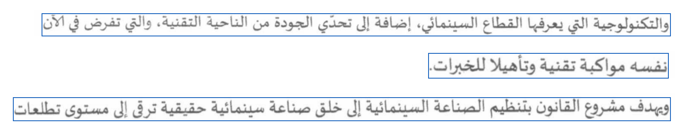

# Vérifications du 11 novembre 2026

Cette livraison consolide l'inférence et la préparation des futurs corpus. Elle ne réentraîne pas les checkpoints
historiques et n'ajoute pas de score AtlasOCRBench.

## Chemin de calcul réel

Le checkpoint mixte (époque 5) a été chargé sur la RTX 5070 et sur CPU. Une page de contrôle a été composée à partir
des trois premières lignes du manifest Gazette train local. Les trois bandes ont été détectées dans l'ordre et
reconnues par lots de deux. Les exports JSON et UTF-8 TXT ont été produits sur CPU.

Il s'agit de lignes déjà disponibles dans l'entraînement, assemblées pour vérifier la chaîne page → crops → OCR.
Cette image ne mesure pas la généralisation à une page inédite. Source : corpus Bulletin officiel, attribution dans
le README du projet.

## Interface

Gradio **5.50.0** a été installé dans un environnement local distinct. Un serveur temporaire lié à `127.0.0.1` a
répondu HTTP 200. Les deux appels à son API, en mode ligne puis en mode page, ont renvoyé du texte ; le second a
renvoyé trois lignes avec coordonnées. Aucun lien public n'a été créé. Le serveur a été arrêté après le test.

## Régressions

La suite couvre le CTC, les métriques, la segmentation, l'orientation EXIF, la transparence, les petits bruits, la
limitation des lots, les exports protégés, la validation des manifests et le rendu arabe. Les nouvelles vérifications
de données contrôlent la séparation par source, la validation fixe avec/sans augmentation, les diacritiques visibles
et la déduplication SHA-256 entre splits. L'audit des données Gazette est ignoré si le corpus local n'est pas trouvé
depuis le clone ; il reste exécutable dans l'arborescence d'origine.

Résultat : **52 tests réussis, 1 ignoré**. Un lot corrigé de 100 textes Atlas a également été généré et validé :
86 lignes train, 14 validation, avec 18 groupes source train et 2 groupes validation disjoints.

Commande : `python -m pytest -q tests`. Les tests unitaires de démo n'ont pas besoin de Gradio ; le test HTTP ci-dessus
complète leur contrôle en exécutant l'interface et un vrai checkpoint.
