# Architecture du projet

Le projet sépare clairement la préparation des données, la reconnaissance d'une ligne, l'entraînement CTC et
l'évaluation. Les images AtlasOCR ne sont pas converties automatiquement en annotations de lignes : les textes sont
utilisés pour générer un pré-entraînement synthétique, tandis que le benchmark reste réservé au test.

```mermaid
flowchart LR
    subgraph data ["Sources de données"]
        gazette["Bulletin officiel marocain\nLignes arabes réelles"]
        doda["DODa\nTextes Darija"]
        atlas["AtlasOCR\nTextes et exemples"]
        bench["AtlasOCRBench\nTest réservé"]
    end

    subgraph prep ["Préparation"]
        fetch["Récupération bornée\ndes textes"]
        render["Rendu synthétique\navec polices arabes"]
        validate["Validation manifest\nCTC et déduplication"]
        split["Train / validation"]
    end

    subgraph recognizer ["Reconnaissance d'une ligne"]
        input["Image de ligne"]
        preprocess["Niveaux de gris\nredimensionnement"]
        cnn["CNN\nextraction visuelle"]
        rtl["Inversion de l'axe\nRTL valide"]
        bilstm["BiLSTM\ncontexte séquentiel"]
        linear["Projection linéaire\nclasses + blank CTC"]
        decode["Décodage glouton CTC"]
        output["Transcription"]
    end

    subgraph objective ["Entraînement"]
        target["Texte de référence"]
        loss["CTC Loss\nalignement latent"]
        checkpoint["Best checkpoint\nCER validation"]
    end

    subgraph release ["Évaluation et publication"]
        metrics["CER / WER / exactitude"]
        plots["Notebooks et graphiques"]
        github["GitHub\ncode et documentation"]
        hf["Hugging Face\ncheckpoints"]
    end

    gazette -->|"baseline réel"| validate
    doda -->|"textes"| render
    atlas -->|"textes bornés"| fetch
    fetch --> render
    render --> validate
    validate --> split
    split --> preprocess
    input --> preprocess
    preprocess --> cnn
    cnn --> rtl
    rtl --> bilstm
    bilstm --> linear
    linear --> decode
    decode --> output
    target --> loss
    linear --> loss
    loss --> checkpoint
    checkpoint --> metrics
    output --> metrics
    bench -.->|"évaluation finale"| metrics
    metrics --> plots
    checkpoint --> github
    checkpoint --> hf
```



## Objectif CTC

Pour une ligne image `x` et une transcription cible `y`, le réseau produit une séquence de probabilités `P` avec
un symbole blanc. La fonction CTC somme les alignements possibles entre les trames visuelles et les caractères,
ce qui évite d'annoter la position exacte de chaque caractère.

```text
x → CNN → BiLSTM → projection CTC → P
                                  ↘ CTC(P, y) → mise à jour des poids
```

## Limite actuelle

Le modèle reconnaît une image contenant une seule ligne. Pour une page complète, une étape supplémentaire de
détection des lignes et de reconstruction de l'ordre de lecture sera nécessaire.
